# Examples

Each file under [`examples/`] is a complete model that renders on its own. Every
one exposes its geometry as a `part()` module.

## 01_elbow

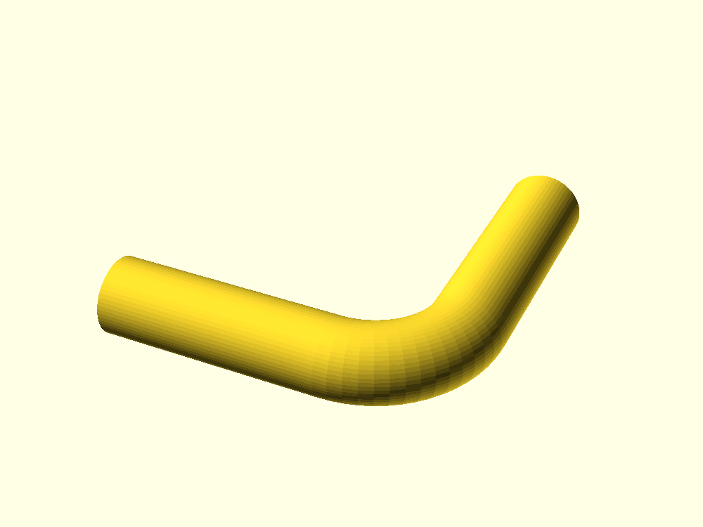

The smallest useful model: a hollow 90° elbow from three waypoints. [Source][`01_elbow`].

## 02_polyline_run

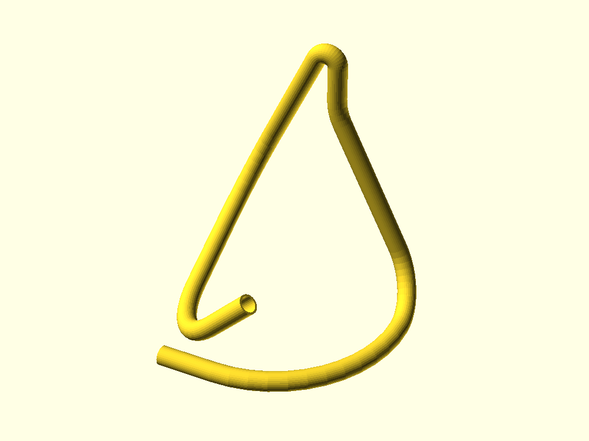

A long 3D run with a different fillet radius at each of six bends. [Source][`02_polyline_run`].

## 03_turtle_route

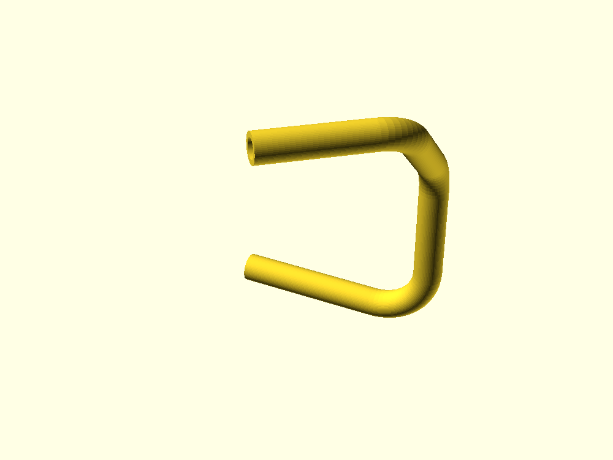

A bender program. `roll` puts later bends in a different plane. [Source][`03_turtle_route`].

## 04_helix

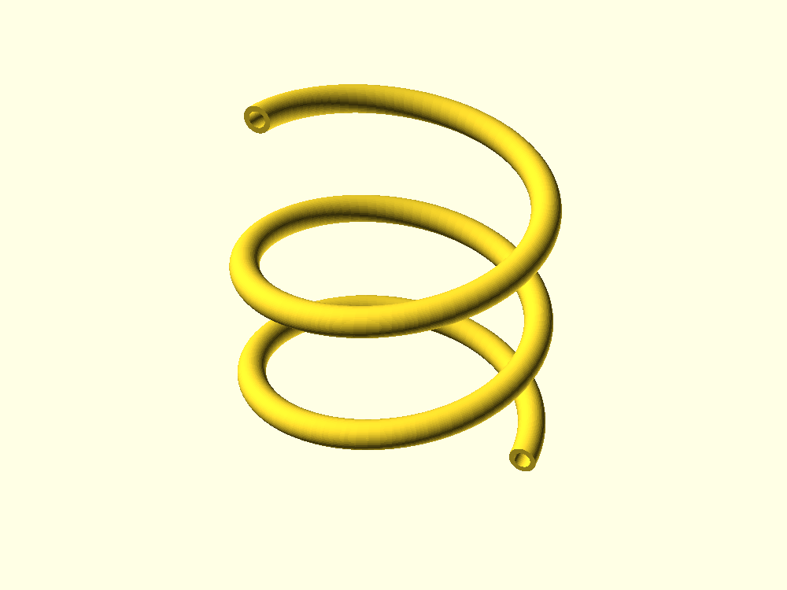

A parametric coil with `ut_curve`, with exact tangents from `dfdt`. [Source][`04_helix`].

## 05_split_conduit

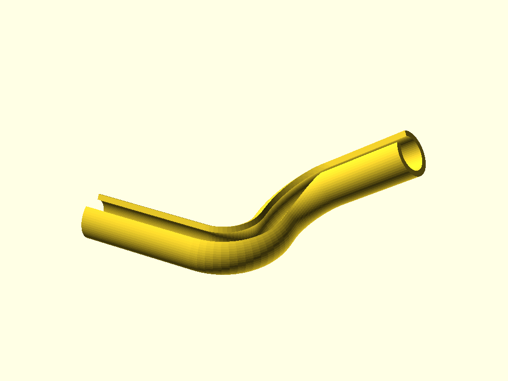

A C-section whose gap faces up along two bends: a split profile plus `frame = "fixed"`. [Source][`05_split_conduit`].

## 06_manifold_4into1

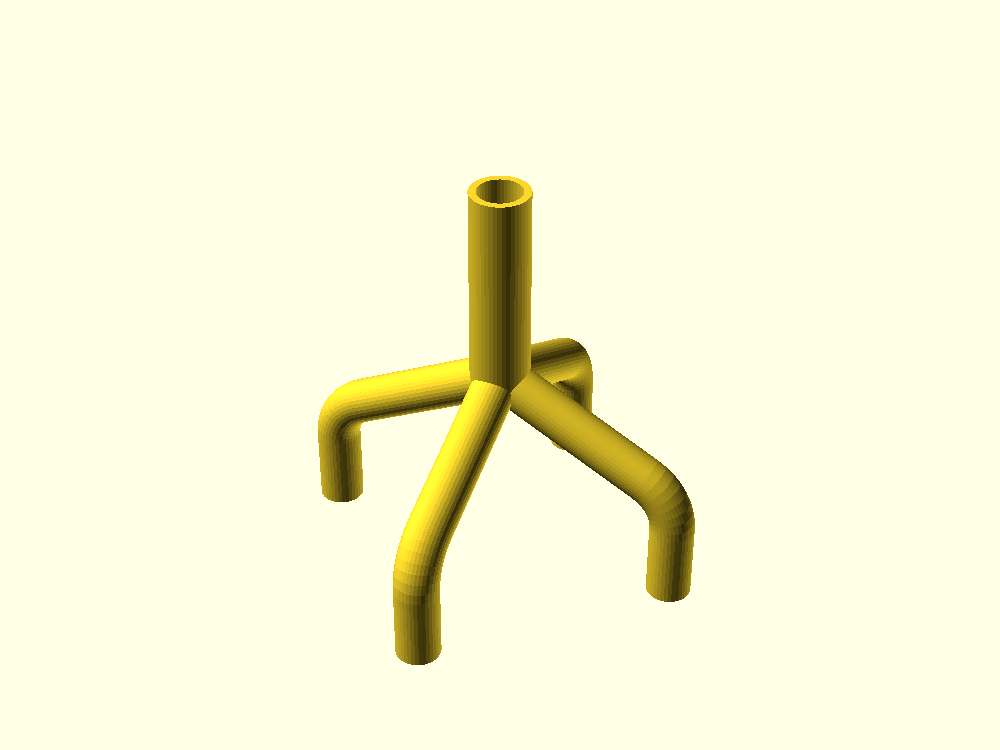

Four inlets converging on one outlet at a single declared joint. [Source][`06_manifold_4into1`].

## 07_ports_debug

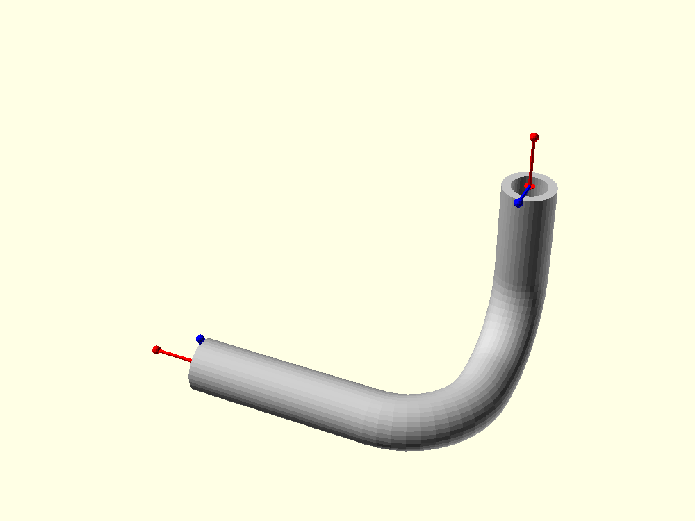

Port frames drawn as arrows: outward direction in red, roll reference in blue. [Source][`07_ports_debug`].

## 08_coaxial_jacket

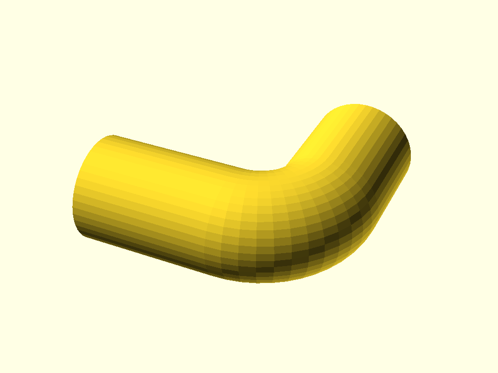

A tube inside a tube, kept apart by lumen groups. [Source][`08_coaxial_jacket`].

## 09_square_bore

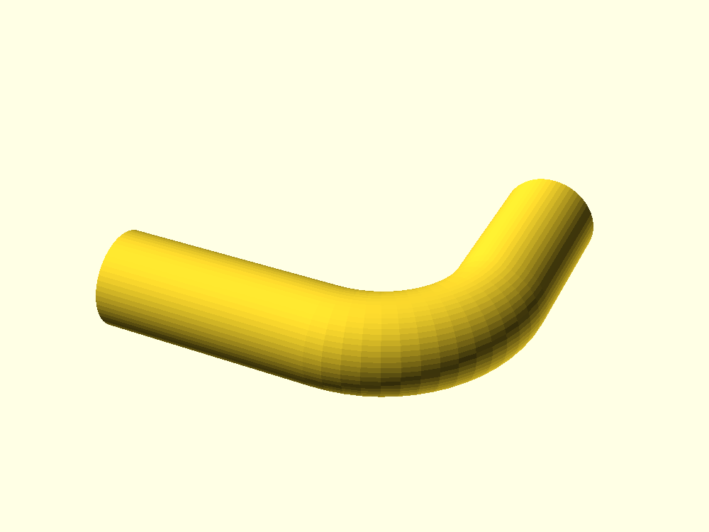

An arbitrary section: a square bore in a round tube, sampled by angle. [Source][`09_square_bore`].

## 10_tee_wall_landing

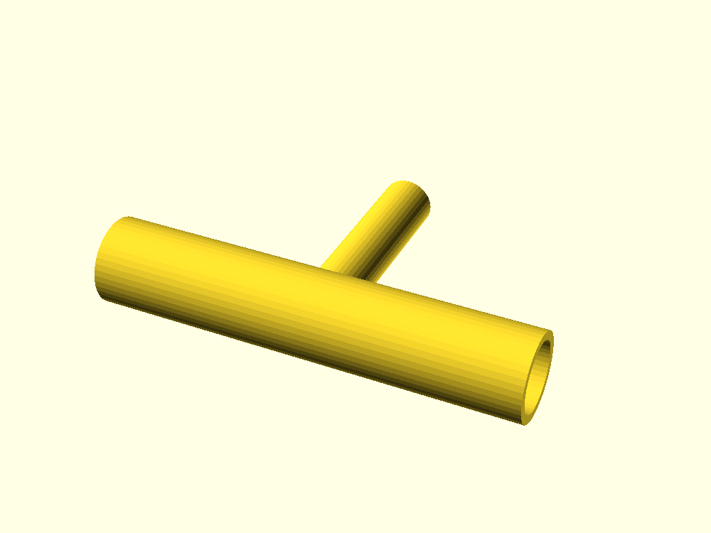

A branch drawn from the trunk's outer wall, joined mid-run. [Source][`10_tee_wall_landing`].

## 11_closed_loop

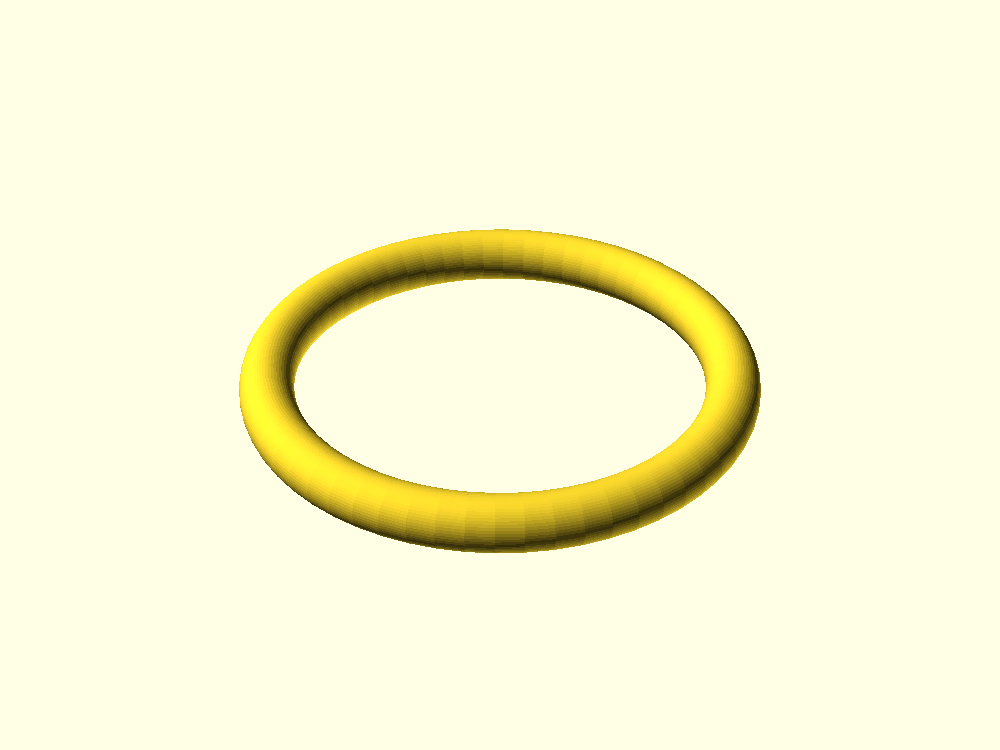

A closed path. Its bore is a sealed cavity. [Source][`11_closed_loop`].

## 12_section_view

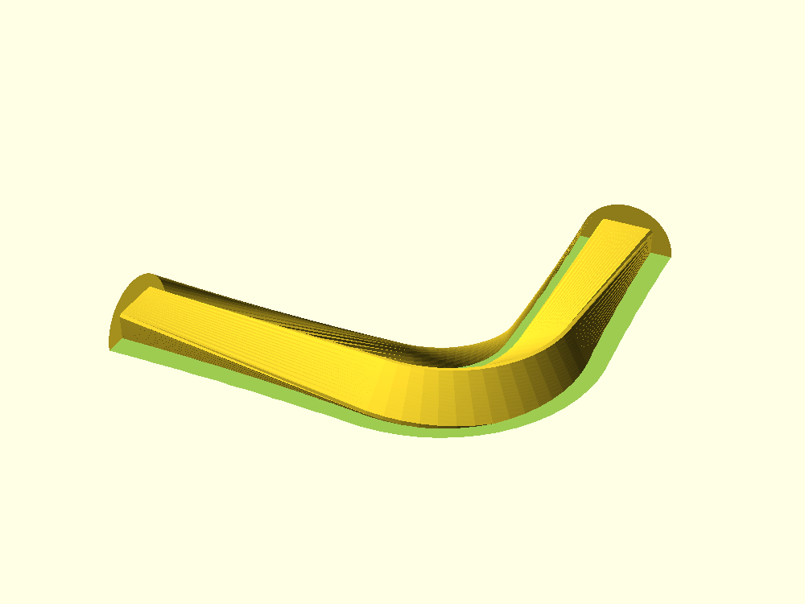

`ut_cutaway` on a twisted square-bore tube, so the roll is visible on the cut face. [Source][`12_section_view`].

To render them all to `out/render/`:

```sh
just render
```

> **Known issue ([#33]).** `12_section_view` applies `twist` across straight
> legs, where the tube necks: its outer radius is 8.56 mm at mid-leg against a
> nominal 9.

[`examples/`]: https://github.com/CameronBrooks11/uniTube/tree/main/examples
[`01_elbow`]: https://github.com/CameronBrooks11/uniTube/blob/main/examples/01_elbow.scad
[`02_polyline_run`]: https://github.com/CameronBrooks11/uniTube/blob/main/examples/02_polyline_run.scad
[`03_turtle_route`]: https://github.com/CameronBrooks11/uniTube/blob/main/examples/03_turtle_route.scad
[`04_helix`]: https://github.com/CameronBrooks11/uniTube/blob/main/examples/04_helix.scad
[`05_split_conduit`]: https://github.com/CameronBrooks11/uniTube/blob/main/examples/05_split_conduit.scad
[`06_manifold_4into1`]: https://github.com/CameronBrooks11/uniTube/blob/main/examples/06_manifold_4into1.scad
[`07_ports_debug`]: https://github.com/CameronBrooks11/uniTube/blob/main/examples/07_ports_debug.scad
[`08_coaxial_jacket`]: https://github.com/CameronBrooks11/uniTube/blob/main/examples/08_coaxial_jacket.scad
[`09_square_bore`]: https://github.com/CameronBrooks11/uniTube/blob/main/examples/09_square_bore.scad
[`10_tee_wall_landing`]: https://github.com/CameronBrooks11/uniTube/blob/main/examples/10_tee_wall_landing.scad
[`11_closed_loop`]: https://github.com/CameronBrooks11/uniTube/blob/main/examples/11_closed_loop.scad
[`12_section_view`]: https://github.com/CameronBrooks11/uniTube/blob/main/examples/12_section_view.scad
[#33]: https://github.com/CameronBrooks11/uniTube/issues/33
